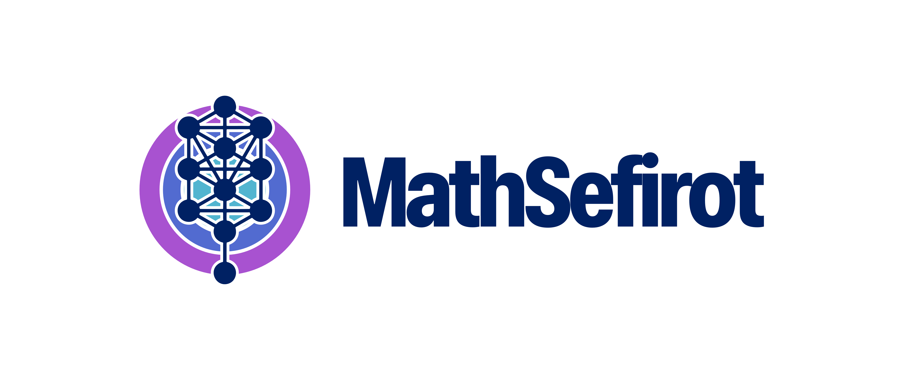
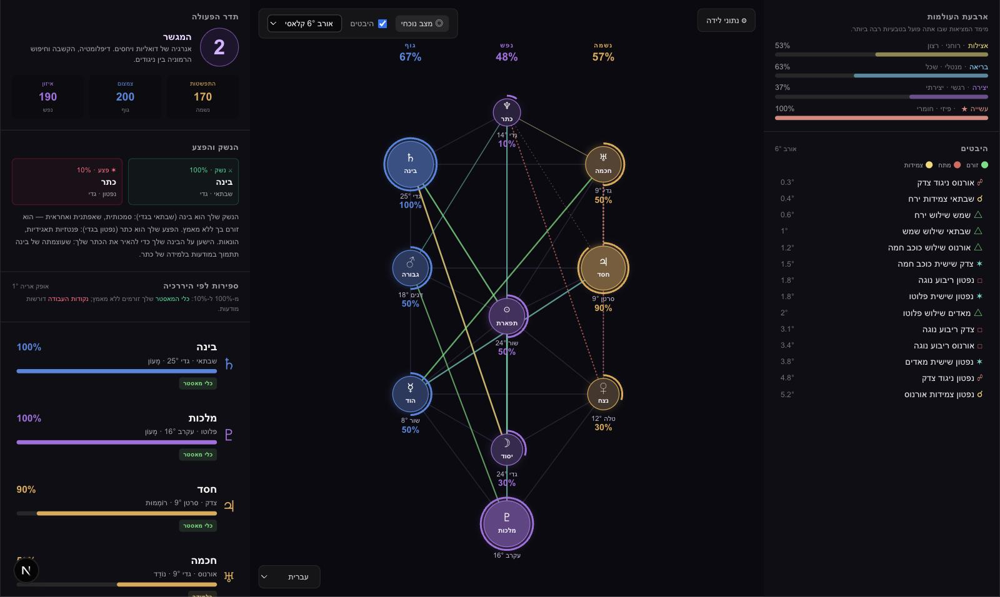

# MathSefirot



> Your natal chart, projected onto the Kabbalistic Tree of Life — where astronomy, gematria and the Sefirot meet.

**MathSefirot** turns a birth date, time and place into a living **Tree of Life**. It computes the real geocentric positions of the ten classical planets, maps each one onto its corresponding Sefirah, and renders the result as an interactive, fully multilingual diagram. Every planet "charges" its sphere according to its astrological dignity, and the three pillars (Soul / Body / Psyche) are read together as a single **Operating Frequency**.

The entire interface **and all of the esoteric data** are translated into **English (default), Hebrew (עברית, right‑to‑left) and Spanish (Español)**, so anyone can use it 100% in their own language.



---

## What it does

MathSefirot is a single-page console that blends three traditions into one coherent reading:

- **🪐 Real astronomy.** Planetary longitudes are computed with [`astronomy-engine`](https://github.com/cosinekitty/astronomy) — true geocentric ecliptic positions of the date, plus a precise Ascendant from local sidereal time. No native dependencies, no API keys.
- **🌳 The Tree of Life.** The 10 Sefirot map 1:1 onto the 10 planets (Golden Dawn attribution, adapted to the Soul / Body / Psyche pillar scheme). Each sphere's glow and intensity reflect how powerfully its planet expresses itself in the chart.
- **🔢 Gematria.** Your name and birth date are reduced through classical Hebrew (Mispar Hechrachi) and Latin ciphers into the three pillars, yielding a symbolic number for Soul, Body and Psyche.

### Highlights

| Feature | Description |
| --- | --- |
| **Operating Frequency** | The three pillars synthesised into a single root number (1–9) with its archetypal meaning. |
| **The Weapon & the Wound** | Your strongest and weakest spheres, read as your natural talent and your point of growth. |
| **The 4 Worlds** | Atziluth · Briah · Yetzirah · Assiah — the dimension of reality where you operate most naturally. |
| **Aspects** | Conjunctions, sextiles, squares, trines and oppositions drawn live between spheres, with adjustable orb (3° / 6° / 8°). |
| **Current transits** | Overlay today's planetary positions as an outer ring and see how each sphere shifts (Δ) from your natal chart. |
| **Dignities** | Domicile · Exaltation · Peregrine · Detriment · Fall drive each sphere's intensity (100 → 10 %), with the decanate blend explained. |

---

## Languages

English is the default. Use the language selector (bottom‑right of the canvas, or inside the birth‑data form) to switch at any time — the change is **instant** and does not recompute your chart.

| Language | Code | Direction |
| --- | --- | --- |
| English | `en` | LTR |
| עברית (Hebrew) | `he` | **RTL** — the whole layout mirrors automatically |
| Español | `es` | LTR |

Everything is localised: UI labels, the 10 Sefirot and their roles, the 12 zodiac signs, the 10 planets, the 5 dignities, all 120 planet‑in‑sign descriptions, the 4 Worlds, aspect names, gematria meanings and the generated diagnostic narratives. Your choice is remembered in `localStorage`.

---

## Tech stack

- **[Next.js](https://nextjs.org/) (App Router)** + **React 19**
- **[D3](https://d3js.org/)** for the SVG Tree of Life
- **[Tailwind CSS](https://tailwindcss.com/) v4**
- **[astronomy-engine](https://github.com/cosinekitty/astronomy)** for ephemerides
- **TypeScript**, end to end
- Geocoding via the free [Open‑Meteo](https://open-meteo.com/) API (no key required)

---

## Getting started

```bash
# install dependencies
npm install

# run the dev server
npm run dev -- -p 3033
```

Then open <http://localhost:3033>, fill in a name, birth date, time and city, pick your language, and **Generate Sefirot**.

```bash
# production build
npm run build
npm start
```

---

## How a reading is built

```
birth data ──▶ local time → UTC ──▶ planetary longitudes (astronomy-engine)
                                         │
                                         ▼
                      each planet → sign + degree → dignity → intensity %
                                         │
                                         ▼
                      Sefirah is "charged" → pillar totals → Operating Frequency
                                         │
                                         ▼
                 Tree of Life + aspects + gematria, rendered in your language
```

---

## Project structure

```
src/
├── app/
│   ├── api/chart/      # natal chart computation endpoint
│   ├── api/geocode/    # city search (Open-Meteo)
│   ├── layout.tsx      # root layout + LocaleProvider
│   └── page.tsx        # the console UI
├── components/
│   └── TreeOfLife.tsx  # the D3-rendered Tree
└── lib/
    ├── astrology/      # ephemeris, dignities, aspects, profiles, geocoding
    ├── gematria/       # Hebrew + Latin gematria
    ├── sefirot/        # Tree of Life definition (10 Sefirot, 22 paths, 4 Worlds)
    └── i18n/           # full EN / HE / ES translation layer
```

---

## Disclaimer

MathSefirot is an instrument for **reflection and study**. It combines astronomy with symbolic traditions (Kabbalah, astrology, gematria) and is **not** intended as scientific, medical, psychological or financial advice.
